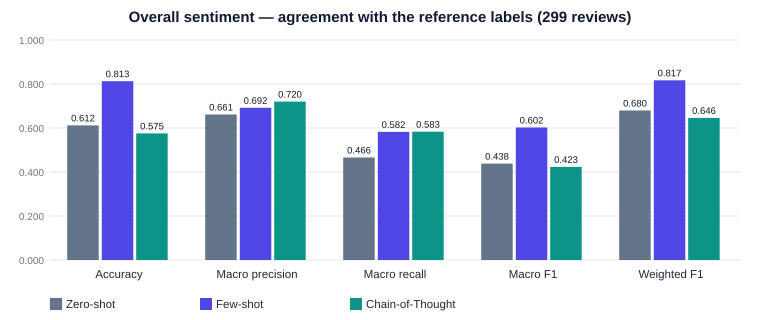
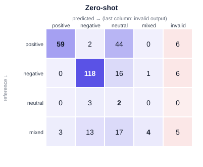
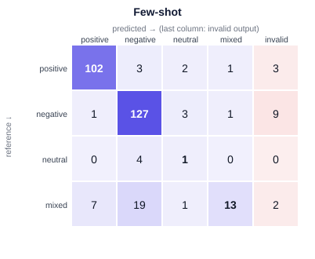
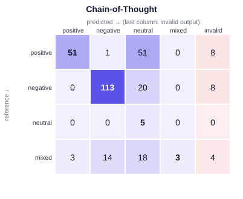
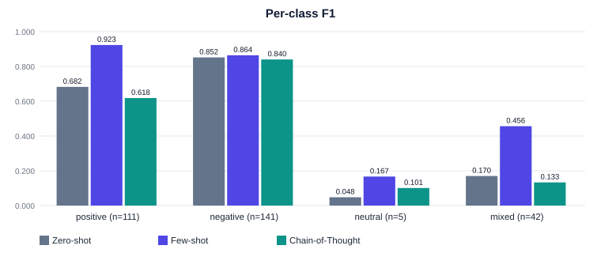
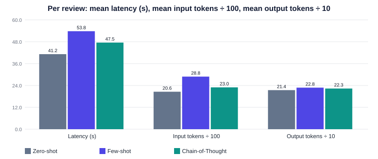
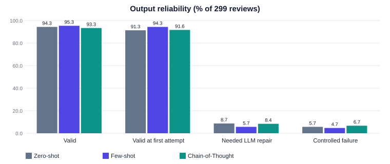
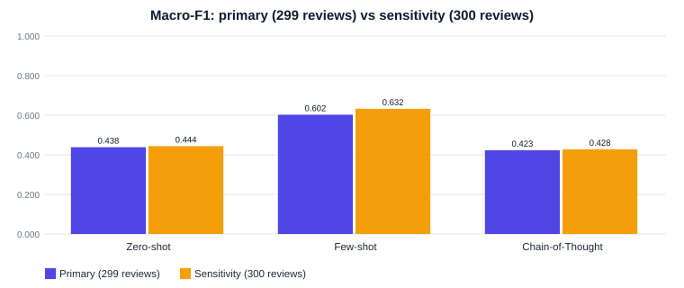

# ReviewIQ — Deliverable 2: Prompt Engineering Experiments (final report)

Run `20261111-030912_qwen2.5-3b` · generated 2026-11-14 17:26 UTC by `scripts/build_d2_report.py` · team: Rachit S Mane, P. Chinni Krishna Reddy, Pranav V. Menon, Akash R.

> **Every number in this report was recomputed with the Python standard library from the raw prediction files and the reference annotations, and matched against the stored results: primary evaluation vs `metrics.json` 96 / 96 values identical; sensitivity analysis vs `approved_reference/metrics.json` 72 / 72 identical (tolerance 1e-4).** The reference labels are **298 AI-assisted + 1 human**: the metrics measure agreement with mentor-approved AI-assisted reference labels, **not** accuracy against independent human ground truth.

## 1. Abstract

We compared three prompting strategies — zero-shot, few-shot and Chain-of-Thought (CoT) — for structured review extraction with a local 3-billion-parameter model (`qwen2.5:3b` on Ollama, temperature 0.0). Each strategy processed the same 299 Amazon appliance reviews, and every output was validated against a Pydantic schema with automatic repair. On overall sentiment (4 classes), **few-shot was best on every headline metric**: macro-F1 0.6025 versus 0.4380 (zero-shot) and 0.4232 (CoT), accuracy 0.8127, and the highest output validity (95.3 %). Zero-shot and CoT label many mildly positive reviews as neutral; all strategies struggle with the rare neutral class (5 examples) and with mixed reviews. Few-shot costs about 40 % more input tokens and 31 % more latency than zero-shot. Because 298 of the 299 reference labels are AI-assisted, the results are agreement with an AI-assisted reference and need confirmation on independent human labels. A sensitivity analysis on the approved 300-review reference set, which adds one formerly excluded review, gives macro-F1 0.4435 / 0.6322 / 0.4276 with the same ranking; the 299-review evaluation remains the primary result.

## 2. Introduction

Star ratings say *how much* customers like a product, not *why*. ReviewIQ turns free-text reviews into validated structured records (overall sentiment, aspects with sentiment and verbatim evidence, complaint categories). Deliverable 1 built and verified the extraction pipeline; Deliverable 2, reported here, asks which prompting strategy produces the most accurate and reliable records with a small local model, and at what cost.

## 3. Objectives

1. Compare zero-shot, few-shot and CoT prompting on the same reviews, model and settings.
2. Measure accuracy, macro and weighted precision / recall / F1, per-class performance and confusion matrices.
3. Measure reliability (schema validity, repairs, controlled failures) and efficiency (latency, tokens).
4. Verify every metric independently and state the provenance of the reference labels honestly.

## 4. Dataset and reference annotations

| Item | Value |
|---|---|
| Source | Amazon Reviews 2023, category Appliances; 1,500 reviews from 15 products (`data/processed/reviews.csv`) |
| Annotation sample | **300 reviews** (300 unique ids), stratified by star rating, seed 42, covering 15 products; rating distribution {'1.0': 62, '2.0': 55, '3.0': 60, '4.0': 60, '5.0': 63} |
| Excluded from evaluation | 1 review: `R5cfb12ef75b4` (status *flagged*: text garbled / unreadable) |
| **Evaluated set** | **299 reviews** (299 unique ids, all in the sample) = 300 − 1 excluded |
| Reference labels on the evaluated set | 299: **1 human** (annotator Akash) + **298 AI-assisted** |
| AI-assisted labels | Claude (Anthropic); labels written by the coding assistant from the review text only (star rating not used); approval: project mentor (as reported by the team); 76 marked `DEBATABLE` |
| Reference class distribution | positive 111 · negative 141 · neutral 5 · mixed 42 |

**300 vs 299.** The annotation sample has 300 reviews. One (`R5cfb12ef75b4`) was flagged as unreadable before the experiment, so the run evaluated 299 (the **primary evaluation**, §9–§13). That review was not predicted in this run. It was later approved as a reference label and predicted separately (2026-11-14, `supplementary/`); it enters **only** the sensitivity analysis in §14.

**Reference approval (2026-11-14).** All 300 / 300 reference annotations were accepted by a named reviewer (Rachit; decisions in `data/annotations/reference_adjudication.json`, no label corrected). Approval records acceptance only: the original provenance is unchanged (accepted labels: 1 human-created, 299 AI-assisted). Independent human annotation (blind labelling plus verification by a second person) is a separate process and is not used in any result here.

**Provenance.** The labels are stored in `data/annotations/annotations.json` with the human / AI-assisted split in `meta.annotation_method` and an `AI-assisted label` note on every AI-assisted record. They were not changed for this report. No output of the evaluated model was ever written into the label file.

## 5. Experimental environment

| Setting | Value |
|---|---|
| Run id / created | `20261111-030912_qwen2.5-3b` / 2026-11-11T03:09:12+00:00 |
| Provider / model | ollama / `qwen2.5:3b` (local; no cloud API) |
| Temperature | 0.0 |
| Prompt version | v1 |
| Max output tokens / context window | 1024 / 8192 |
| Timeout per call | 300 s |
| Max LLM repair attempts | 2 |
| Strict evidence grounding | True |
| Git commit at run start | `045f16b` |
| Hardware | student laptop with a 4 GB GPU; GPU thermal watchdog active during inference |

## 6. Prompting strategies

| Strategy | Prompt content (prompts/) | Mean input tokens |
|---|---|---|
| Zero-shot | system role, extraction rules, taxonomy with definitions, JSON output format | 2057.4 |
| Few-shot | zero-shot content + 5 synthetic labelled demonstrations written by the team (not from the dataset): overall labels positive, negative, mixed, negative (compatibility issue), neutral (no product aspects) | 2884.5 |
| Chain-of-Thought | zero-shot content + a 7-step analysis procedure (split statements, map aspects, decide sentiments, map complaints, weigh positive vs negative for the overall label, verify evidence) carried out *silently*; output is only the JSON with a 1–2 sentence `rationale` (no reasoning trace is stored) | 2297.6 |

All strategies share the same schema, taxonomy, extraction rules, repair loop and model settings; only the prompt differs. Prompt version `v1` (`prompts/zero_shot.py`, `prompts/few_shot.py`, `prompts/cot.py`).

## 7. Experimental methodology

1. Each strategy processed all 299 reviews once (one attempt per review per strategy; stored outcomes are final and were never re-sampled to improve scores).
2. Every output was parsed and validated against the Pydantic schema (labels from the closed taxonomy, verbatim evidence ≤ 300 characters). Deterministic local fixes were applied first; if still invalid, up to 2 LLM repair attempts followed.
3. An output still invalid after repair is a **controlled failure**: stored with every raw attempt and error, never dropped and never given invented values.
4. **Same review set:** all three prediction files contain final outcomes for exactly the same 299 ids (verified: yes); no missing and no duplicate outcomes.
5. **Denominators and invalid outputs:** every metric uses all 299 reviews. A controlled failure is scored as a wrong prediction (label `__invalid__`): it lowers accuracy and the recall of its true class, it appears in no predicted-class column of the confusion matrix (so a matrix row sums to the class support minus that class's failures), and it does not change any class's precision. Macro averages are the unweighted mean over the 4 sentiment classes; weighted F1 weights each class by its support.

## 8. Evaluation metrics

- **Accuracy** = correct / 299.
- **Precision (class c)** = correct c predictions / all c predictions; **recall** = correct c predictions / reference c reviews; **F1** = harmonic mean.
- **Macro P / R / F1** = unweighted mean over positive, negative, neutral, mixed — every class counts equally, so rare classes matter (headline metric because the sample is stratified by rating, not by sentiment).
- **Weighted F1** = support-weighted mean of class F1.
- **Validity** = valid outputs / 299; **first-attempt validity** = valid with no LLM repair / 299; **LLM repairs** = reviews that needed at least one LLM repair call.
- **Latency / tokens** = per review, including repair calls, averaged over all 299 outcomes.

## 9. Primary results — 299 reviews

| Strategy | Accuracy | Macro P | Macro R | **Macro F1** | Weighted F1 | Correct / 299 | Invalid |
|---|---|---|---|---|---|---|---|
| Zero-shot | 0.6120 | 0.6611 | 0.4659 | 0.4380 | 0.6797 | 183 | 17 |
| **Few-shot** | 0.8127 | 0.6917 | 0.5823 | **0.6025** | 0.8170 | 243 | 14 |
| Chain-of-Thought | 0.5753 | 0.7201 | 0.5831 | 0.4232 | 0.6461 | 172 | 20 |

Few-shot leads on accuracy (+0.2007 over zero-shot), macro-F1 (+0.1645) and weighted F1. CoT has the highest macro precision (0.7201) but the lowest accuracy: it predicts mixed and positive rarely but correctly, and pushes many reviews into neutral.

## 10. Confusion matrix analysis

Rows = reference label, columns = prediction (order positive, negative, neutral, mixed); the extra column counts invalid outputs for that reference class.

**Zero-shot**

| reference \ predicted | positive | negative | neutral | mixed | invalid | support |
|---|---|---|---|---|---|---|
| positive | 59 | 2 | 44 | 0 | 6 | 111 |
| negative | 0 | 118 | 16 | 1 | 6 | 141 |
| neutral | 0 | 3 | 2 | 0 | 0 | 5 |
| mixed | 3 | 13 | 17 | 4 | 5 | 42 |

**Few-shot**

| reference \ predicted | positive | negative | neutral | mixed | invalid | support |
|---|---|---|---|---|---|---|
| positive | 102 | 3 | 2 | 1 | 3 | 111 |
| negative | 1 | 127 | 3 | 1 | 9 | 141 |
| neutral | 0 | 4 | 1 | 0 | 0 | 5 |
| mixed | 7 | 19 | 1 | 13 | 2 | 42 |

**Chain-of-Thought**

| reference \ predicted | positive | negative | neutral | mixed | invalid | support |
|---|---|---|---|---|---|---|
| positive | 51 | 1 | 51 | 0 | 8 | 111 |
| negative | 0 | 113 | 20 | 0 | 8 | 141 |
| neutral | 0 | 0 | 5 | 0 | 0 | 5 |
| mixed | 3 | 14 | 18 | 3 | 4 | 42 |

  

- **Positive → neutral** is the dominant error for zero-shot (44 of 105 valid positive reviews) and CoT (51 of 103); few-shot makes it only 2 times.
- **Mixed → negative** is the dominant error for all strategies (13 / 19 / 14): reviews with both praise and complaints are read as negative.
- **Negative** is recognised well by all three strategies (largest, most clear-cut class).

## 11. Per-class analysis

| Class (support) | Zero-shot P / R / F1 | Few-shot P / R / F1 | Chain-of-Thought P / R / F1 |
|---|---|---|---|
| positive (111) | 0.9516 / 0.5315 / **0.6821** | 0.9273 / 0.9189 / **0.9231** | 0.9444 / 0.4595 / **0.6182** |
| negative (141) | 0.8676 / 0.8369 / **0.8520** | 0.8301 / 0.9007 / **0.8639** | 0.8828 / 0.8014 / **0.8401** |
| neutral (5) | 0.0253 / 0.4000 / **0.0476** | 0.1429 / 0.2000 / **0.1667** | 0.0532 / 1.0000 / **0.1010** |
| mixed (42) | 0.8000 / 0.0952 / **0.1702** | 0.8667 / 0.3095 / **0.4561** | 1.0000 / 0.0714 / **0.1333** |

**Neutral is the weakest class for every strategy** (F1 0.0476, 0.1667, 0.1010). Only 5 of 299 reference labels (1.7 %) are neutral, while the models predict neutral 79, 7, 94 times (zero-shot / few-shot / CoT). With so few true neutrals, almost every neutral prediction is a false positive (precision 0.0253, 0.1429, 0.0532), and a single correct or missed neutral moves its recall by 20 points. Because macro-F1 weights neutral equally with positive (111) and negative (141), this one rare class pulls every macro average down. **Mixed** (42 reviews) is the second weakness: recall 0.0952, 0.3095, 0.0714.

## 12. Efficiency analysis

| Metric (per review, all 299 outcomes) | Zero-shot | Few-shot | Chain-of-Thought |
|---|---|---|---|
| Mean latency | 41.19 s | 53.77 s | 47.53 s |
| Median latency | 25.45 s | 35.81 s | 33.74 s |
| Mean latency, valid / failed outputs | 32.3 s / 188.5 s | 42.3 s / 287.8 s | 36.2 s / 204.9 s |
| Total inference time | 3.42 h | 4.47 h | 3.95 h |
| Mean input tokens | 2057.4 | 2884.5 | 2297.6 |
| Mean output tokens | 214.5 | 227.9 | 223.1 |
| Total input / output tokens | 615,159 / 64,126 | 862,456 / 68,146 | 686,970 / 66,718 |
| Macro-F1 per 1,000 input tokens | 0.213 | 0.209 | 0.184 |

Few-shot's demonstrations make its prompt the longest (40 % more input tokens than zero-shot) and slowest (31 % more latency). Per 1,000 input tokens zero-shot and few-shot deliver almost the same macro-F1 (zero-shot marginally more) and CoT the least, so few-shot buys its large quality gain at a roughly proportional token cost. Failed outputs cost several times more time than valid ones because they include the repair calls. Output length is similar for all strategies because CoT's procedure is performed silently.

## 13. Invalid output and repair analysis

| Metric | Zero-shot | Few-shot | Chain-of-Thought |
|---|---|---|---|
| Valid / controlled failures | 282 / 17 | 285 / 14 | 279 / 20 |
| Validity rate | 94.3 % | 95.3 % | 93.3 % |
| First-attempt validity (no LLM repair) | 91.3 % | 94.3 % | 91.6 % |
| Reviews needing ≥ 1 LLM repair | 26 | 17 | 25 |
| … of which repaired successfully | 9 | 3 | 5 |
| Deterministic local fixes (reviews / fixes) | 12 / 28 | 85 / 110 | 9 / 25 |
| Failures by reference class (pos / neg / neu / mix) | 6 / 6 / 0 / 5 | 3 / 9 / 0 / 2 | 8 / 8 / 0 / 4 |

| Failure cause (first validation error) | Zero-shot | Few-shot | Chain-of-Thought |
|---|---|---|---|
| evidence longer than 300 characters | 4 | 1 | 1 |
| evidence not verbatim | 6 | 5 | 8 |
| invalid JSON | 0 | 3 | 2 |
| label outside the taxonomy | 5 | 5 | 6 |
| rationale too long | 0 | 0 | 3 |
| schema (missing / extra field) | 2 | 0 | 0 |

Most failures are grounding errors (evidence that is not an exact quote or is too long) and labels outside the closed taxonomy — the strict schema rejects them instead of accepting unverifiable output. Few-shot has the most deterministic local fixes but the fewest LLM repairs and failures: its examples show the exact JSON shape, so its errors are small and mechanically fixable. CoT adds its own failure mode (rationale over the length limit).

**Validation success is not classification accuracy.** Validity only says that the output matched the schema (allowed labels, verbatim evidence); it says nothing about whether the label is right. Zero-shot: 282 valid outputs, 183 correct labels, so 99 valid but wrong; Few-shot: 285 valid outputs, 243 correct labels, so 42 valid but wrong; Chain-of-Thought: 279 valid outputs, 172 correct labels, so 107 valid but wrong. CoT's validity (93.3 %) is close to zero-shot's (94.3 %), yet its accuracy is lower, because its valid outputs more often carry the wrong (neutral) label.

## 14. Sensitivity analysis — 300 reviews

After the reference annotations were approved, all three strategies were also scored on the full approved set of 300 reviews (`approved_reference/metrics.json`, evaluated 2026-11-14T16:55:03+00:00). The only difference from the primary evaluation is 1 review:

| Item | Value |
|---|---|
| Review | `R5cfb12ef75b4` |
| Original status | flagged: excluded from the original run (text garbled / unreadable) |
| Reference label | neutral (ai_assisted; note: "AI-assisted label (Claude, mentor-approved; not human-annotated). Confidence 0.30. DEBATABLE - human review recommended. Text is garbled and partly unreadable ("hard to li CV k in the lid...").") |
| Approval | approved individually by Rachit at 2026-11-14T16:53:32+00:00 |
| Predictions | Zero-shot → neutral, Few-shot → neutral, Chain-of-Thought → neutral; produced separately on 2026-11-14 with the same model (`qwen2.5:3b`), prompt version and temperature (`supplementary/`) |

| Strategy | n | Accuracy | Macro P | Macro R | Macro F1 | Weighted F1 | Valid / invalid | Macro F1 change vs primary |
|---|---|---|---|---|---|---|---|---|
| Zero-shot | 300 | 0.6133 | 0.6642 | 0.4909 | 0.4435 | 0.6780 | 283 / 17 | +0.0055 |
| Few-shot | 300 | 0.8133 | 0.7185 | 0.6156 | 0.6322 | 0.8172 | 286 / 14 | +0.0297 |
| Chain-of-Thought | 300 | 0.5767 | 0.7226 | 0.5831 | 0.4276 | 0.6446 | 280 / 20 | +0.0044 |

| Class F1 (support 299 → 300) | Zero-shot 299 → 300 | Few-shot 299 → 300 | Chain-of-Thought 299 → 300 |
|---|---|---|---|
| positive (111 → 111) | 0.6821 → 0.6821 | 0.9231 → 0.9231 | 0.6182 → 0.6182 |
| negative (141 → 141) | 0.8520 → 0.8520 | 0.8639 → 0.8639 | 0.8401 → 0.8401 |
| neutral (5 → 6) | 0.0476 → 0.0698 | 0.1667 → 0.2857 | 0.1010 → 0.1188 |
| mixed (42 → 42) | 0.1702 → 0.1702 | 0.4561 → 0.4561 | 0.1333 → 0.1333 |

**Effect.** The added review is labelled neutral and all three strategies predicted neutral for it, so it adds one correct neutral prediction and brings the neutral class to 6 examples. Positive, negative and mixed results are unchanged. Because neutral is so small, one extra correct example raises its F1 noticeably and, since macro-F1 weights the four classes equally, moves macro-F1 by +0.0055, +0.0297, +0.0044 (zero-shot / few-shot / CoT), while accuracy moves by about 0.001. The ranking (few-shot > zero-shot > CoT on macro-F1) is the same in both evaluations. Both evaluations use identical review ids for all three strategies (primary 299, sensitivity 300).

**Why the 299-review evaluation stays primary.** (1) The review was excluded as unreadable *before* the experiment, so the 299-review set is the pre-specified evaluation; (2) all 299 × 3 predictions come from one run, while the added review was predicted three days later in a separate session; (3) the added label is AI-assisted with low confidence and marked debatable; (4) the sensitivity result shows how strongly a single rare-class example moves macro-F1, which argues for reporting it separately rather than as the headline.

## 15. Discussion

**Why few-shot performed best.** The measured difference is concentrated in one place: few-shot labels 102 positive reviews correctly versus 59 for zero-shot (+43), which is 72 % of its 60 additional correct predictions; positive recall rises from 0.5315 to 0.9189, and mixed recall from 0.0952 to 0.3095. Our interpretation: the five demonstrations show concretely what a positive, mixed, negative and neutral review looks like, so the model no longer treats an ordinary positive review as opinion-free (neutral); and because they show the exact JSON shape, few-shot also has the best first-attempt validity and the fewest failures. (This is an interpretation of the error pattern; the run does not isolate which demonstration causes which effect.)

**Why CoT did not help.** CoT predicts neutral 94 times for 5 true neutrals (recall 1.0000, precision 0.0532), mostly for positive reviews (51) and negative reviews (20). The procedure's step 6 asks the model to weigh positive against negative aspects; our interpretation is that the 3B model, performing this silently, often concludes 'no clear opinion' and falls back to neutral. The procedure did not improve aspect handling either (aspect-detection micro-F1 is lower than zero-shot in `metrics.json`) and it adds one failure mode (rationale over the length limit). Structured reasoning prompts are generally expected to help larger models more than a 3B model; this run does not test that.

**Class imbalance.** The sample is stratified by star rating, not by sentiment, so neutral reviews are rare. Macro-F1 is reported as the headline metric because accuracy would hide the minority classes; the price is that a 5-example class has a large, noisy influence on every macro average.

## 16. Limitations

- **AI-assisted reference labels.** 298 of 299 reference labels were generated by an AI model (Claude (Anthropic); labels written by the coding assistant from the review text only) and approved by the mentor (project mentor (as reported by the team)); only 1 is human. The metrics measure **agreement with these labels**. If the evaluated model and the labelling model share biases, agreement can overstate accuracy; the ranking should be confirmed on independent human labels (a blind two-person workflow exists in the app; 0 of 300 human labels are verified). 76 AI labels are marked `DEBATABLE`. All 300 reference labels were later approved by a named reviewer; approval records acceptance and does not turn them into independent human annotations.
- **Sensitivity to single examples:** with 5–6 neutral reviews, one review changes few-shot macro-F1 by about 0.03 (§14).
- **Small rare classes:** neutral n = 5, mixed n = 42; their per-class scores have wide uncertainty.
- **One model, one run:** `qwen2.5:3b` at temperature 0, one attempt per review; results may differ for larger models, other prompts or other demonstrations, and no confidence intervals or significance tests were computed.
- **Overall sentiment only** is analysed here in depth; aspect and complaint metrics are in `metrics.json` and the D1/D2 reports.
- The sample (300 of 1,500 reviews, stratified by rating) does not reflect the natural rating distribution.

## 17. Conclusion

Few-shot prompting is the best strategy for this task and model: macro-F1 0.6025, accuracy 0.8127, validity 95.3 %, at a moderate cost in tokens and latency. Zero-shot and CoT blur the positive/neutral boundary, and all strategies under-detect mixed and neutral reviews. Every number was independently recomputed and matches the stored results. The evaluation is against mentor-approved, mostly AI-assisted reference labels; confirming the ranking on independent human labels is the main open step. The 300-review sensitivity analysis (macro-F1 0.4435 / 0.6322 / 0.4276) confirms the ranking and shows how sensitive macro-F1 is to the rare neutral class.

## Appendix A. Verification

- Recomputed (stdlib, raw files) vs stored `metrics.json`: **96 / 96 values identical** (tolerance 1e-4), including all confusion matrices.
- Same review set for all strategies: **yes** (299 ids; missing outcomes 0, 0, 0).
- Also verified separately: `scripts/verify_metrics_independent.py` (all match), `scripts/verify_d2_records.py` (11 / 11 PASS).
- Sensitivity analysis recomputed from the raw files (original predictions + `supplementary/`, approved labels) vs `approved_reference/metrics.json`: **72 / 72 values identical**, including the confusion matrices; same 300 ids for all strategies: **yes**; label corrections applied: 0.
- Charts: every value label checked against the data (96 labels in 8 charts, all present).

**Values transcribed from the dashboard screenshots vs verified data**

| Strategy | Value | Transcribed | Verified (run data) | Explanation |
|---|---|---|---|---|
| zero_shot | accuracy | 0.6127 | 0.6120 | 183 correct / 299 = 0.61204 |

49 of 50 transcribed values match the run data exactly; the value(s) above differ and the **verified** value is used throughout this report.

Data file with every number used: `reports/d2/D2_REPORT_DATA.json`.
