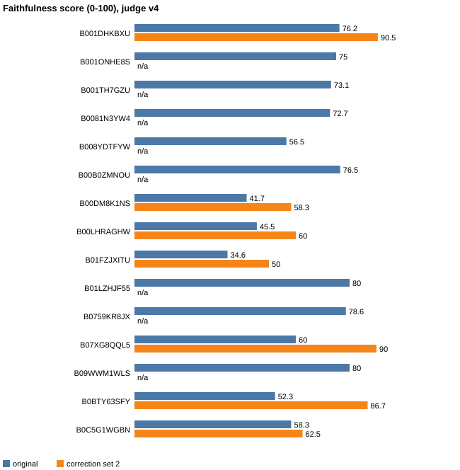
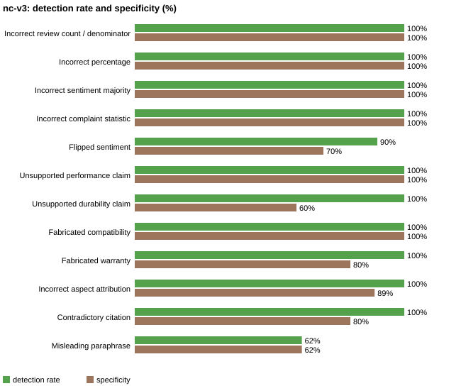

# ReviewIQ — Deliverable 3 Final Report

Aspect-Based Customer Review Analytics with Structured Outputs · Product-level summaries and faithfulness evaluation

Team: Rachit S Mane (PES1UG24AM214), P. Chinni Krishna Reddy (PES1UG24AM209), Pranav V. Menon (PES1UG24AM198), Akash R. (PES1UG24AM212) · Generated 2026-11-15 from stored artefacts (`scripts/build_d3_final_report.py`; numbers re-checked by `scripts/verify_d3_final.py`).

## 1. Abstract
ReviewIQ turns customer reviews into structured aspect-level records, aggregates them per product and generates concise product summaries with a local model (qwen2.5:3b). Earlier LLM-as-a-Judge designs (v1-v3) could not measure faithfulness reliably: v3 verdicts contradicted their own claim lists in 37 of 47 cases. We replaced them with a claim-level evaluator (judge v4): each of the 239 claims in the 15 summaries is checked deterministically (numbers, counts, majorities, aspect statements, citations) and, for cited points, by a local LLM (llama3.2) against only the cited review text, with a mandatory verbatim evidence quote. Scores are derived from the claim statuses, so a score cannot contradict the claims. On the originals, v4 finds 9 contradicted and 44 unsupported claims (mean faithfulness 64.1 / 100) and flags 13 of the 16 errors identified by the earlier manual investigation. On a new pre-registered negative control with 123 planted errors and 123 matched correct claims, the combined evaluator reaches recall 96.7% [91.9%, 98.7%], precision 90.8% and specificity 90.2%. For review-based errors (the part only an LLM can check), recall is 93.7% with specificity 81.0%. The evaluator is useful but not perfectly reliable; its limitations are stated in section 18.

## 2. Introduction
Product summaries generated by language models can state numbers that are not in the data, attribute statistics to the wrong quantity, cite reviews that say the opposite, or generalise from one review to all customers. D3 asks whether such errors can be detected automatically and reproducibly with local resources (Windows laptop, 32 GB RAM, Quadro M2200 with 4 GB VRAM, Ollama; no cloud inference). This report documents the final D3 pipeline, the evaluation architecture that replaced the holistic judge, and the evidence for and against its reliability.

## 3. D3 objectives
| # | Objective | Where addressed | Status |
|---|---|---|---|
| 1 | Extract relevant information from reviews | §5 (reused D2 few-shot extraction) | done |
| 2 | Aggregate at product level | §6 | done |
| 3 | Generate concise product summaries | §7 | done (15 summaries) |
| 4 | Evaluate faithfulness with an LLM-as-a-Judge | §9-12 (judge v4) | done; reliability measured in §15-16 |
| 5 | Check claims against original review evidence | §8-9 (verbatim quote check, cited reviews only) | done |
| 6 | Test reliability with deliberately corrupted summaries | §14-16 (nc-v3, with clean controls) | done |
| 7 | Reproducible results and final report | §10, Appendix B, this report | done |

## 4. Dataset description
The dataset holds 1,500 Amazon appliance reviews for 15 products (`data/processed/reviews.csv`). D3 uses the D2 annotation sample (299 reviews after one flagged review was removed); 285 reviews have a valid extraction and 14 are controlled failures. Per product the summaries rest on 9-42 reviews. The 300 independent human annotations (human-created, blind, not second-person verified) label overall sentiment; only a handful carry aspect or complaint labels (8 of 300 carry aspect labels and 2 carry complaint labels), so they are used only in a separate sentiment-aggregation check (§17) and as one agreement signal when choosing negative-control anchors, never as claim-level ground truth.

## 5. Extraction methodology
Each review is extracted by qwen2.5:3b with the few-shot prompt chosen in D2 into a Pydantic `ReviewRecord` (overall sentiment, aspects with sentiment and a verbatim evidence span, complaint categories), with deterministic fixes and at most two repair calls (`pipeline/extraction.py`, `pipeline/repair.py`). Output: `outputs/live/extractions/dataset__few_shot__qwen2.5-3b__v1.jsonl` (reused from D2, unchanged). D2 measured complaint micro-precision 0.367 for this strategy, so complaint statistics can be inflated (§17).

## 6. Product-level aggregation
`pipeline/aggregation.py` (pandas only, no LLM) computes per product: sentiment counts and percentages, average rating, per-aspect positive/negative/neutral mentions and net sentiment, complaint counts and percentages (denominator = all reviews), reviews with complaints, a yearly trend and up to ten evidence quotes. Judge v4 re-reads these statistics for every numeric check; the audit re-aggregates them identically from the extraction file.

## 7. Summary generation
qwen2.5:3b receives the statistics and the evidence quotes (not the full reviews) and returns `ProductSummaryContent`: an overall opinion, up to six appreciated points and six complaints (each citing 1-3 review ids from the evidence), frequent aspects, improvement areas and recommendations (`prompts/summarization.py`, rules: copy numbers only from the statistics; improvement areas must follow from complaints). 15 summaries were generated (`outputs/live/summaries/summaries.jsonl`); they are the evaluated artefacts and were never modified.

## 8. Evidence traceability
All 130 cited review ids exist and belong to the right product (re-verified by v4's citation check: every point claim records `exists` and `belongs_to_product` per citation). Traceability alone is not faithfulness: the investigation found points whose only citation says the opposite. v4 therefore resolves every cited id to its original review text and requires the LLM to quote the sentence it relied on; the quote must be an exact (normalised: case, whitespace, punctuation, '...' gaps) substring of the cited text or the verdict becomes UNVERIFIABLE. 89.5% of all stored LLM verdicts carried a verified quote.

## 9. Claim-level evaluation architecture
1. **Decomposition** (`evaluation/claims.py`, no LLM): each overall-opinion sentence, each appreciated/complaint point (with its own citations), the frequent-aspect list, and each improvement area and recommendation becomes one claim. Claim text is verbatim; ids are stable (`<summary_id>:<field>:<index>`). Each claim gets a category (12 categories), a polarity and a numeric flag.
2. **Deterministic checks** (`evaluation/claim_checks.py`): counts, denominators, percentages (±0.5 points), average rating, majority/plurality/'slight' wording, 'mixed' wording, most-frequent aspects, most-common complaint, universal quantifiers ('all reviewers'), aspect statements ('users appreciate X but face issues with Y'), numbers in points that must occur in the cited text, citation validity, and derived claims (improvement areas need negative evidence). Every numeric check stores the extracted value, expected value, denominator and calculation.
3. **LLM verification** (`evaluation/judge_v4.py`): only for point claims (and opinion sentences no deterministic rule covers). One call per claim; the evidence is the full text of the claim's cited reviews only (other reviews are never shown). Output `{evidence_quote, explanation, status}` under Ollama constrained decoding.
4. **Combination**: the worse of the deterministic and LLM verdicts wins; a definite deterministic finding is never overridden by a better or an UNVERIFIABLE LLM verdict; an LLM verdict of SUPPORTED, PARTIALLY_SUPPORTED or CONTRADICTED without a verified quote becomes UNVERIFIABLE; an improvement area is supported if a complaint point of the same summary was verified for that aspect.
5. **Derived scores** (`schemas/claim_schema.py`): computed from statuses only; `SummaryEvaluationV4` re-derives counts, lists and score on validation and refuses to load an inconsistent record.

| Method | Claims (15 originals) |
|---|---|
| deterministic | 155 |
| llm | 84 |
| deterministic+llm | 0 |
| none | 0 |

## 10. Judge prompt and model configuration
| Setting | Value |
|---|---|
| judge model | ollama/llama3.2 (different family from the qwen2.5 summariser) |
| temperature | 0.0 |
| num_ctx / num_predict | 4096 / 384 |
| constrained decoding | True |
| calls per claim / repairs | 1 / 0 |
| prompt SHA-256 | 988ef24e271e7983fe402b4e878de35f035b3d4f46470db5490fb760fafe7471 |
| valid LLM verdicts / validation failures | 258 / 0 |
| mean latency per call | 17.9 s (sequential, GPU guard active) |

System prompt (verbatim; the user message gives the claim, its role and the evidence):
```
You are a careful fact-checker. You check ONE claim taken from a summary of customer reviews against the EVIDENCE given below it. Use ONLY the evidence; ignore anything you believe about the product.

Choose exactly one status:
SUPPORTED - the evidence directly says what the claim says. Reasonable paraphrase is fine. A claim about "users" or "customers" is supported if the cited reviews say it.
PARTIALLY_SUPPORTED - part of the claim is supported, but another part is missing, or the claim is broader, stronger or more specific than the evidence (for example "all users" when one review says it).
UNSUPPORTED - the evidence does not mention what the claim says.
CONTRADICTED - the evidence says the opposite of the claim, or gives a different value.
UNVERIFIABLE - the evidence is too unclear or garbled to decide.

Rules:
1. "evidence_quote": first find the sentence in the EVIDENCE that is most relevant to the claim and copy it word for word, exactly as written (same words, same order). Never leave it empty. Write NONE only if no sentence in the evidence is about the topic of the claim.
2. "explanation": one or two sentences saying what the evidence says about the claim.
3. "status": one of SUPPORTED, PARTIALLY_SUPPORTED, UNSUPPORTED, CONTRADICTED, UNVERIFIABLE.
4. If the claim has several parts (for example joined by "and"), check every part. If one part is not in the evidence, the status is at most PARTIALLY_SUPPORTED.
Return one JSON object: {"evidence_quote": "...", "explanation": "...", "status": "..."}

Examples (a different product):
CLAIM: The toaster browns bread evenly.
EVIDENCE: [R1] (rating 5/5) Toast comes out evenly browned every time. Love it.
{"evidence_quote": "Toast comes out evenly browned every time", "explanation": "The review says the toast is evenly browned.", "status": "SUPPORTED"}

CLAIM: The toaster is easy to clean.
EVIDENCE: [R2] (rating 2/5) Cleaning the crumb tray is a nightmare and it rattles.
{"evidence_quote": "Cleaning the crumb tray is a nightmare", "explanation": "The review says cleaning is very hard, the opposite of the claim.", "status": "CONTRADICTED"}

CLAIM: The toaster comes with a three-year warranty.
EVIDENCE: [R3] (rating 4/5) Works fine and arrived quickly.
{"evidence_quote": "NONE", "explanation": "The review does not mention any warranty.", "status": "UNSUPPORTED"}

CLAIM: All users say the toaster is quiet and fast.
EVIDENCE: [R4] (rating 4/5) It is very quiet in the morning.
{"evidence_quote": "It is very quiet in the morning", "explanation": "One review says it is quiet; nothing about speed or about all users.", "status": "PARTIALLY_SUPPORTED"}
----
CLAIM ({role}): {claim}

EVIDENCE ({evidence_kind}):
{evidence}

Return the JSON object for this claim.
```

## 11. Scoring methodology
`faithfulness = 100 * max(0, (S + 0.5*P + 0*U - 1*C) / (S + P + U + C)); UNVERIFIABLE claims are excluded from the denominator and reported as (1 - evidence_coverage). Caps: any CONTRADICTED claim -> score <= 60; any UNSUPPORTED claim -> score <= 80; 'perfect' (100) only if every verifiable claim is SUPPORTED.`

Rationale: a supported claim earns full credit and a partially supported one half; an unsupported claim earns nothing; a contradicted claim actively misinforms the reader, so it subtracts a full claim. UNVERIFIABLE claims (advice that cannot be checked, or an LLM verdict without a verifiable quote) are excluded rather than counted as errors, and the excluded share is reported as evidence coverage; below 50 % coverage the summary is marked INSUFFICIENT_EVIDENCE. The caps make the validity rules hard: any contradicted claim keeps the score at or below 60, any unsupported claim at or below 80, and 100 requires every verifiable claim to be supported. Validity labels: FAITHFUL, MINOR_ISSUES, UNSUPPORTED_CLAIMS, CONTRADICTED_CLAIMS, INSUFFICIENT_EVIDENCE. The weights were fixed before any v4 result existed. Sensitivity (§12): over six alternative weightings the Kendall τ of the product ranking against the primary scores ranges from 0.804 to 1.0.

## 12. Original summary evaluation
15 summaries, 239 claims: SUPPORTED 142, PARTIALLY_SUPPORTED 29, UNSUPPORTED 44, CONTRADICTED 9, UNVERIFIABLE 15. Numeric claims: 18, of which 5 failed a deterministic check. Validity: CONTRADICTED_CLAIMS 5, UNSUPPORTED_CLAIMS 10. Mean faithfulness 64.1 / 100.

| Product | Claims | S | P | U | C | Unverif. | Numeric failed | Coverage | Score | Validity |
|---|---|---|---|---|---|---|---|---|---|---|
| B001DHKBXU | 22 | 15 | 2 | 4 | 0 | 1 | 1 | 95% | 76.2 | UNSUPPORTED_CLAIMS |
| B001ONHE8S | 14 | 10 | 1 | 3 | 0 | 0 | 0 | 100% | 75 | UNSUPPORTED_CLAIMS |
| B001TH7GZU | 13 | 8 | 3 | 2 | 0 | 0 | 0 | 100% | 73.1 | UNSUPPORTED_CLAIMS |
| B0081N3YW4 | 12 | 7 | 2 | 2 | 0 | 1 | 0 | 92% | 72.7 | UNSUPPORTED_CLAIMS |
| B008YDTFYW | 24 | 11 | 4 | 8 | 0 | 1 | 0 | 96% | 56.5 | UNSUPPORTED_CLAIMS |
| B00B0ZMNOU | 18 | 13 | 0 | 4 | 0 | 1 | 0 | 94% | 76.5 | UNSUPPORTED_CLAIMS |
| B00DM8K1NS | 14 | 6 | 2 | 2 | 2 | 2 | 1 | 86% | 41.7 | CONTRADICTED_CLAIMS |
| B00LHRAGHW | 14 | 7 | 0 | 2 | 2 | 3 | 0 | 79% | 45.5 | CONTRADICTED_CLAIMS |
| B01FZJXITU | 13 | 5 | 1 | 6 | 1 | 0 | 1 | 100% | 34.6 | CONTRADICTED_CLAIMS |
| B01LZHJF55 | 18 | 14 | 1 | 2 | 0 | 1 | 0 | 94% | 80 | UNSUPPORTED_CLAIMS |
| B0759KR8JX | 15 | 10 | 2 | 2 | 0 | 1 | 0 | 93% | 78.6 | UNSUPPORTED_CLAIMS |
| B07XG8QQL5 | 11 | 7 | 2 | 0 | 1 | 1 | 0 | 91% | 60 | CONTRADICTED_CLAIMS |
| B09WWM1WLS | 14 | 11 | 2 | 1 | 0 | 0 | 0 | 100% | 80 | UNSUPPORTED_CLAIMS |
| B0BTY63SFY | 24 | 12 | 5 | 2 | 3 | 2 | 2 | 92% | 52.3 | CONTRADICTED_CLAIMS |
| B0C5G1WGBN | 13 | 6 | 2 | 4 | 0 | 1 | 0 | 92% | 58.3 | UNSUPPORTED_CLAIMS |



### Known errors from the investigation
The investigation (`reports/proposed_revisions_2026-11-15/`) listed 16 concrete errors by reading the summaries against the statistics and cited reviews (investigator reading, not a human gold set). v4 marks 13 of them UNSUPPORTED or CONTRADICTED and 16 as anything other than SUPPORTED:

| Product | Claim | Known error | v4 status | Method |
|---|---|---|---|---|
| B0BTY63SFY | overall_opinion:1 | '80% of the reviews' positive (actual 86.7%; 80% = performance share) | CONTRADICTED | deterministic |
| B0BTY63SFY | overall_opinion:3 | '67% of negative reviews' (no such statistic) | CONTRADICTED | deterministic |
| B0BTY63SFY | appreciated:2 | 'suitable for larger eggs' cites a review saying larger eggs do not fit | CONTRADICTED | llm |
| B0BTY63SFY | complaints:2 | 'small legs' misreads a typo ('Only small legs fit' = eggs) | PARTIALLY_SUPPORTED | llm |
| B0BTY63SFY | improvement_areas:3 | durability improvement with 3 positive / 0 negative durability mentions | UNSUPPORTED | deterministic |
| B0BTY63SFY | recommendations:3 | durability recommendation without negative evidence | UNSUPPORTED | deterministic |
| B001DHKBXU | overall_opinion:2 | complaint counts given 'out of 15' (15 = reviews with complaints; 19 reviews) | PARTIALLY_SUPPORTED | deterministic |
| B001DHKBXU | complaints:1 | 'installation was difficult' cites a review saying 'easy to install' | UNSUPPORTED | llm |
| B001DHKBXU | complaints:2 | 'poor value' unsupported by its citation | UNSUPPORTED | llm |
| B001DHKBXU | complaints:4 | 'compatibility issues' not in either cited review | UNSUPPORTED | llm |
| B00DM8K1NS | overall_opinion:0 | '3 positive reviews out of 13' (actual 5) and 'slightly positive' (negative > positive) | CONTRADICTED | deterministic |
| B00LHRAGHW | overall_opinion:0 | 'slight majority of positive' (40% positive vs 50% negative) | CONTRADICTED | deterministic |
| B01FZJXITU | overall_opinion:0 | '(7 out of 9) praising performance and price value' (4 and 2) | CONTRADICTED | deterministic |
| B07XG8QQL5 | overall_opinion:0 | 'majority of users' with performance/durability issues (31.6% each) | CONTRADICTED | deterministic |
| B07XG8QQL5 | complaints:0 | performance complaint cites two 5-star positive reviews | PARTIALLY_SUPPORTED | llm |
| B0C5G1WGBN | appreciated:1 | 'good value' cites a 1-star complaint that does not mention value | UNSUPPORTED | llm |

### Weight sensitivity
| Weighting | Mean score | Kendall τ vs primary |
|---|---|---|
| primary (S1, P0.5, U0, C-1, caps) | 64.1 | 1 |
| P=0.25 | 61.5 | 0.962 |
| P=0.75 | 66.5 | 0.804 |
| C=0 (contradicted = unsupported) | 67.2 | 0.9 |
| C=-2 | 60.3 | 0.981 |
| strict (only SUPPORTED counts) | 62.3 | 0.838 |
| primary weights, no caps | 65.5 | 1 |

## 13. Corrected summary evaluation
Corrections are separate, labelled artefacts with new ids; the originals are untouched. Correction set 1 (`-corr1`, 2026-11-14) fixed the misattributed percentages of B0BTY63SFY and the denominators of B001DHKBXU. Correction set 2 (`-corr2`, 2026-11-15, `scripts/build_corrected_summaries_v2.py`) fixes exactly the errors named in the investigation, for 7 products; every edit records the old and new text, the reason and verbatim review quotes (checked to be substrings) or recomputed statistics. The edit list was fixed before v4 evaluated any corrected copy. Provenance: written by the AI coding assistant, not by the summariser and not human-approved. Each copy was evaluated independently by v4 under its own id. The flags that remain on corrected copies are on points the corrections did not touch; several are LLM false positives of the kind measured in §16 (for example, 'The product is not durable and breaks easily' marked CONTRADICTED by a review saying it broke after a few months), so the corrected scores are not an upper bound of what correction can achieve.

| Product | Set | Copy id | Original score | Corrected score | Original validity | Corrected validity | Corrected C/U |
|---|---|---|---|---|---|---|---|
| B001DHKBXU | corr1 | 2f2f868f0ec7-corr1 | 76.2 | 78.6 | UNSUPPORTED_CLAIMS | UNSUPPORTED_CLAIMS | 0/4 |
| B0BTY63SFY | corr1 | a61df84f4901-corr1 | 52.3 | 60 | CONTRADICTED_CLAIMS | CONTRADICTED_CLAIMS | 1/2 |
| B0BTY63SFY | corr2 | a61df84f4901-corr2 | 52.3 | 86.7 | CONTRADICTED_CLAIMS | MINOR_ISSUES | 0/0 |
| B001DHKBXU | corr2 | 2f2f868f0ec7-corr2 | 76.2 | 90.5 | UNSUPPORTED_CLAIMS | MINOR_ISSUES | 0/0 |
| B00DM8K1NS | corr2 | 2fb2110754ba-corr2 | 41.7 | 58.3 | CONTRADICTED_CLAIMS | CONTRADICTED_CLAIMS | 1/2 |
| B00LHRAGHW | corr2 | 329800146f6c-corr2 | 45.5 | 60 | CONTRADICTED_CLAIMS | CONTRADICTED_CLAIMS | 1/2 |
| B01FZJXITU | corr2 | f336d1f67313-corr2 | 34.6 | 50 | CONTRADICTED_CLAIMS | UNSUPPORTED_CLAIMS | 0/6 |
| B07XG8QQL5 | corr2 | b575f6ccde9d-corr2 | 60 | 90 | CONTRADICTED_CLAIMS | MINOR_ISSUES | 0/0 |
| B0C5G1WGBN | corr2 | 95d7c1c7e9d5-corr2 | 58.3 | 62.5 | UNSUPPORTED_CLAIMS | UNSUPPORTED_CLAIMS | 0/3 |

Edits in correction set 2:

| Product | Field | Action | Old | New | Reason |
|---|---|---|---|---|---|
| B0BTY63SFY | appreciated | replace_point | The containers are suitable for holding larger eggs and fit well in the fridge. | The containers hold small to large chicken eggs and fit in the fridge. | the only citation (R80f511ff60c4) says larger eggs do NOT fit ('larger eggs the let will not close properly') |
| B0BTY63SFY | complaints | replace_point | The containers do not fit properly for larger eggs and are too tall for the container. | Larger eggs such as duck eggs are too tall for the container, and with larger eggs the lid may not close prope | garbled wording ('containers ... too tall for the container'); the eggs are too tall |
| B0BTY63SFY | complaints | replace_point | The containers have small legs that do not fit properly. | The small feet on the bottom have to line up just right, or the stack can slide around. | 'small legs' misreads 'Only small legs fit' (R80f511ff60c4, a typo for eggs); the cited review talks about little feet |
| B0BTY63SFY | overall_opinion | remove_sentence | Customers also had concerns about the installation setup and usability. |  | sentence removed: 'installation setup' is an extraction artefact (lid snapping labelled as installation) and the usability concern is 1 nega |
| B0BTY63SFY | improvement_areas | replace_item | Optimizing the installation setup for better fit and stability. | Making the lid easier to snap on and seal. | same extraction artefact |
| B0BTY63SFY | improvement_areas | remove_item | Enhancing the design and material quality for durability. |  | no review complains about durability or material (quality_durability 3 positive / 0 negative) |
| B0BTY63SFY | improvement_areas | replace_item | Ensuring the containers fit properly with the included legs. | Making the feet line up more easily so that stacked containers do not slide. | 'included legs' does not exist (misreading) |
| B0BTY63SFY | recommendations | replace_item | Ensure that the included legs are compatible with the container design. | Redesign the feet so that stacked containers lock in place. | 'included legs' does not exist (misreading) |
| B0BTY63SFY | recommendations | remove_item | Invest in better material quality and design for increased durability. |  | no review complains about durability or material (quality_durability 3 positive / 0 negative) |
| B0BTY63SFY | recommendations | remove_item | Ensure that the included legs fit properly with the container design. |  | duplicate of the legs recommendation, based on the same misreading |
| B001DHKBXU | overall_opinion | replace_text | received a mixed to negative overall sentiment | received a predominantly negative overall sentiment | 0 of 19 reviews are mixed and 15 of 19 (78.9%) are negative |
| B001DHKBXU | complaints | replace_point | Installation was difficult and the part did not work as intended. | Some reviewers had to modify or adjust the mounting to install it, and one installed part did not work at all. | cited R326a034e9581 says 'easy to install' (it supports the opposite appreciated point) |
| B001DHKBXU | complaints | replace_point | The product did not provide good value for money. | One reviewer felt it was not worth the money because it quit working within months. | cited R28878e067e18 contains no value complaint about this part (it compares Sears' price) |
| B001DHKBXU | complaints | replace_point | The product had issues with functionality and customer service. | Parts failed or arrived not working, and one reviewer advised against buying from the seller. | the cited reviews criticise the seller, not customer service |
| B001DHKBXU | complaints | replace_point | The product did not perform as expected and had compatibility issues. | Several parts stopped working within weeks or months, and one did not fit right without adjustment. | neither cited review reports incompatibility (an uncited review even says 'exact match') |
| B00DM8K1NS | overall_opinion | replace_text | has a mixed overall sentiment with a neutral to slightly positive tone, indicated by the average star rating o | has a mixed overall sentiment with a slightly negative tone: the average star rating is 3.38, with 5 positive  | 5 (not 3) of 13 reviews are positive and negative (6) outnumbers positive (5) |
| B00LHRAGHW | overall_opinion | replace_text | The product received mixed feedback with a slight majority of positive reviews, indicating that the product is | The product received mixed feedback, with slightly more negative (5 of 10) than positive (4 of 10) reviews, an | positive is 40% and negative 50%: the original claims the wrong direction |
| B01FZJXITU | overall_opinion | replace_text | as indicated by the majority of reviews (7 out of 9) praising its performance and price value. | with 7 of the 9 reviews positive and praise mainly for its performance and price value. | 7 is the number of positive reviews; positive mentions of performance (4) and price value (2) are fewer |
| B07XG8QQL5 | overall_opinion | replace_text | The dryer has received mixed reviews with a majority of users experiencing performance issues and poor durabil | The dryer has received mostly negative reviews (13 of 19), with performance issues and poor durability among t | performance_issue and poor_durability are each mentioned in 6 of 19 reviews (31.6%), not by a majority |
| B07XG8QQL5 | complaints | replace_point | Performance issues are the most common complaint, with users experiencing heating coil failure and sensor malf | Performance issues are among the most common complaints; one reviewer received a dead sensor. | two of the three citations (R86c40cc45487, R30ffca1cf480) are 5-star positive reviews, and R00181bfd96a7 says the heating element works |
| B0C5G1WGBN | appreciated | replace_point | It offers good value for money, as seen in reviews like [R4cc079d33dae]. | It offers good value for money, as seen in reviews like [R1a5040c839f6] and [R83348325447b]. | cited R4cc079d33dae is a 1-star complaint that says nothing about value |

Not fixable in a summary: B001DHKBXU's complaint statistics are inflated by extraction errors (about 2 of 7 installation_difficulty and 1 of 6 poor_value labels match the review text); fixing them requires re-extraction, which would change D2-derived artefacts.

## 14. Negative-control methodology
The 30 earlier copies (nc-v2: invented feature, fabricated statistic) and their v2/v3 results are unchanged. The new control **nc-v3** (`evaluation/negative_control_v3.py`) has 123 cases over 12 error types; each case is one planted (corrupted) claim and one matched correct (clean) claim of the same form, so false positives can be measured. It was generated with seed 20261115, frozen on 2026-11-15 before any judging (dataset SHA-256 `d1b5684475e4c49089a0d1e14a6b286faa2d21e5f83523648d3685b690ff60d7`), and the runner refuses a dataset whose hash differs. Statistic types use the product aggregate. Review-based types are anchored on reviews where three signals agree: an extraction aspect whose evidence span is verbatim in the review and contains wording for that aspect and polarity, the star rating, and the human overall sentiment. Fabricated details are planted only where their key words are absent from the cited review (brands: from all reviews of the product). Before freezing, every review-based case was read against its review by the AI assistant; ambiguous cases led to rule changes before freezing, never after. Detection is read from the evaluator's status on the planted claim itself.

| Error type | Cases | Expected status | Example corrupted claim |
|---|---|---|---|
| Incorrect review count / denominator | 15 | CONTRADICTED | 16 of the 19 reviews are negative. |
| Incorrect percentage | 15 | CONTRADICTED | 91.6% of the reviews are negative. |
| Incorrect sentiment majority | 15 | CONTRADICTED | The majority of reviews are positive. |
| Incorrect complaint statistic | 15 | CONTRADICTED | Poor durability is mentioned in 11 of the 19 reviews. |
| Flipped sentiment | 10 | CONTRADICTED | A reviewer reports that the part fits their appliance. |
| Unsupported performance claim | 9 | UNSUPPORTED | A reviewer reports that it works twice as fast as the original part. |
| Unsupported durability claim | 5 | UNSUPPORTED | A reviewer reports that the product has lasted more than five years without any problems. |
| Fabricated compatibility | 7 | UNSUPPORTED | A reviewer reports that the part also fits Samsung and Bosch models. |
| Fabricated warranty | 10 | UNSUPPORTED | A reviewer reports that the product comes with a two-year manufacturer warranty. |
| Incorrect aspect attribution | 9 | UNSUPPORTED | A reviewer reports that the product arrived late or damaged. |
| Contradictory citation | 5 | CONTRADICTED | A reviewer reports that the part does not fit their appliance. |
| Misleading paraphrase | 8 | PARTIALLY_SUPPORTED | All reviewers agree that the product was delivered promptly. |

Detection rules (pre-registered in the manifest): **primary**: flagged = final status in {UNSUPPORTED, CONTRADICTED}; for misleading_paraphrase (expected PARTIALLY_SUPPORTED) flagged = final status != SUPPORTED. The same per-type rule is applied to the matched clean claims.; **strict**: flagged = final status in {UNSUPPORTED, CONTRADICTED} for every type; **lenient**: flagged = final status != SUPPORTED for every type (PARTIALLY_SUPPORTED and UNVERIFIABLE count as flagged)

## 15. Negative-control results
| Error type | Cases | Detected | Rate | 95% CI | Clean flagged | Specificity | LLM-only detected | Deterministic-only detected |
|---|---|---|---|---|---|---|---|---|
| Incorrect review count / denominator | 15 | 15 | 100% | [79.6%, 100.0%] | 0 | 100% | n/a | 15 |
| Incorrect percentage | 15 | 15 | 100% | [79.6%, 100.0%] | 0 | 100% | n/a | 15 |
| Incorrect sentiment majority | 15 | 15 | 100% | [79.6%, 100.0%] | 0 | 100% | n/a | 15 |
| Incorrect complaint statistic | 15 | 15 | 100% | [79.6%, 100.0%] | 0 | 100% | n/a | 15 |
| Flipped sentiment | 10 | 9 | 90% | [59.6%, 98.2%] | 3 | 70% | 9/10 | 0 |
| Unsupported performance claim | 9 | 9 | 100% | [70.1%, 100.0%] | 0 | 100% | 9/9 | 0 |
| Unsupported durability claim | 5 | 5 | 100% | [56.6%, 100.0%] | 2 | 60% | 5/5 | 0 |
| Fabricated compatibility | 7 | 7 | 100% | [64.6%, 100.0%] | 0 | 100% | 7/7 | 0 |
| Fabricated warranty | 10 | 10 | 100% | [72.2%, 100.0%] | 2 | 80% | 10/10 | 0 |
| Incorrect aspect attribution | 9 | 9 | 100% | [70.1%, 100.0%] | 1 | 89% | 9/9 | 0 |
| Contradictory citation | 5 | 5 | 100% | [56.6%, 100.0%] | 1 | 80% | 5/5 | 0 |
| Misleading paraphrase | 8 | 5 | 62% | [30.6%, 86.3%] | 3 | 62% | 5/8 | 3 |



Summary-level effect: inserting the corrupted claim instead of its clean twin gives a lower faithfulness score in 97 of 123 pairs, equal in 26, higher in 0 (copy-level scores are recomputed from the original summary's claim verdicts plus the planted claim's verdict). For comparison, v3 gave the corrupted nc-v2 copy a lower faithfulness score in only 3 of 30 pairs.

## 16. Precision, recall, F1 and specificity
| Rule | Layer | TP | FP | TN | FN | Precision | Recall | Recall 95% CI | F1 | Specificity | Spec. 95% CI | FPR |
|---|---|---|---|---|---|---|---|---|---|---|---|---|
| primary | combined | 119 | 12 | 111 | 4 | 90.8% | 96.7% | [91.9%, 98.7%] | 93.7% | 90.2% | [83.7%, 94.3%] | 9.8% |
| primary | deterministic | 63 | 0 | 123 | 60 | 100.0% | 51.2% | [42.5%, 59.9%] | 67.7% | 100.0% | [97.0%, 100.0%] | 0.0% |
| primary | llm | 59 | 12 | 51 | 4 | 83.1% | 93.7% | [84.8%, 97.5%] | 88.1% | 81.0% | [69.6%, 88.8%] | 19.0% |
| strict | combined | 119 | 12 | 111 | 4 | 90.8% | 96.7% | [91.9%, 98.7%] | 93.7% | 90.2% | [83.7%, 94.3%] | 9.8% |
| strict | deterministic | 63 | 0 | 123 | 60 | 100.0% | 51.2% | [42.5%, 59.9%] | 67.7% | 100.0% | [97.0%, 100.0%] | 0.0% |
| strict | llm | 59 | 12 | 51 | 4 | 83.1% | 93.7% | [84.8%, 97.5%] | 88.1% | 81.0% | [69.6%, 88.8%] | 19.0% |
| lenient | combined | 119 | 17 | 106 | 4 | 87.5% | 96.7% | [91.9%, 98.7%] | 91.9% | 86.2% | [79.0%, 91.2%] | 13.8% |
| lenient | deterministic | 78 | 0 | 123 | 45 | 100.0% | 63.4% | [54.6%, 71.4%] | 77.6% | 100.0% | [97.0%, 100.0%] | 0.0% |
| lenient | llm | 59 | 17 | 46 | 4 | 77.6% | 93.7% | [84.8%, 97.5%] | 84.9% | 73.0% | [61.0%, 82.4%] | 27.0% |

Layers: *combined* is the final v4 status; *deterministic* counts a claim as flagged only from deterministic findings; *llm* uses the LLM verdict alone (after the quote check) on the claims the LLM judged. The statistic types are detected deterministically by design (the checks and the generator were written by the same author), so their perfect detection says the checks work, not that the problem is hard. The informative numbers are the review-based types:

| Review-based types (primary rule) | TP | FP | TN | FN | Precision | Recall | Recall 95% CI | Specificity |
|---|---|---|---|---|---|---|---|---|
| combined | 59 | 12 | 51 | 4 | 83.1% | 93.7% | [84.8%, 97.5%] | 81.0% |
| deterministic | 3 | 0 | 63 | 60 | 100.0% | 4.8% | [1.6%, 13.1%] | 100.0% |
| llm | 59 | 12 | 51 | 4 | 83.1% | 93.7% | [84.8%, 97.5%] | 81.0% |

Comparison of judge versions:

|  | v1 | v2 | v3 | v4 |
|---|---|---|---|---|
| Unit of evaluation | whole summary | whole summary | whole summary | one claim + its cited reviews |
| Valid outputs | 5 / 15 | 15 / 15 | 47 / 47 | 258 verdicts, 0 failures |
| Score/claim contradictions | 4 of 5 valid | forced away by validator (H = 4 for all) | 37 / 47 | 0 (impossible by construction, tested) |
| Planted-error detection | 3-pair sanity check only | 18 / 30 (nc-v2) | 5 / 30 (nc-v2) | 119 / 123 (nc-v3); review-based 59 / 63 |
| False positives measured | no | no | no | yes: 12 of 123 clean claims flagged |
| Numbers checked by | LLM | LLM | LLM | deterministic code |

## 17. Error analysis
**Missed planted errors (4).** Status of each missed corrupted claim and the evaluator's explanation:

| Case | Type | Corrupted claim | Status | Explanation (truncated) |
|---|---|---|---|---|
| nc-v3-079 | Flipped sentiment | A reviewer reports that the part does not fit their appliance. | SUPPORTED | LLM (SUPPORTED): The review says the part fits well. |
| nc-v3-116 | Misleading paraphrase | All reviewers agree that the product was delivered promptly. | SUPPORTED | LLM (SUPPORTED): The review confirms that the product was delivered promptly. |
| nc-v3-117 | Misleading paraphrase | A reviewer reports that the part fits their appliance, calling it the best purchase they h | SUPPORTED | LLM (SUPPORTED): The review says the part fits their appliance and works as expected. |
| nc-v3-123 | Misleading paraphrase | A reviewer reports that the product arrived late or damaged, calling it the worst purchase | SUPPORTED | LLM (SUPPORTED): The reviewer reports that the product arrived damaged and had to be returned for a refund. |

**False positives on clean claims (12).**

| Case | Type | Clean claim | Status | Explanation (truncated) |
|---|---|---|---|---|
| nc-v3-063 | Contradictory citation | A reviewer reports that the product is well made. | UNSUPPORTED | LLM (UNSUPPORTED): The review mentions the product's quality. |
| nc-v3-074 | Flipped sentiment | A reviewer reports that the product works well. | UNSUPPORTED | LLM (UNSUPPORTED): The review says the product works as expected, but does not say it works well. |
| nc-v3-075 | Flipped sentiment | A reviewer reports that the product is well made. | UNSUPPORTED | LLM (UNSUPPORTED): The review says the product is sturdy, but does not explicitly say it is well made. |
| nc-v3-082 | Flipped sentiment | A reviewer reports that the product works well. | UNSUPPORTED | LLM (UNSUPPORTED): The review says the product works, but also mentions a separate vent for a bathroom window as a minor issue. [quote NOT found in the evidence: verdict  |
| nc-v3-092 | Unsupported durability claim | A reviewer reports that the product is well made. | UNSUPPORTED | LLM (UNSUPPORTED): The review says the basket is sturdy and has no problems. |
| nc-v3-093 | Unsupported durability claim | A reviewer reports that the product is poorly made or did not last. | UNSUPPORTED | LLM (UNSUPPORTED): The review mentions a specific problem with the product's compatibility with a part, but does not directly state that the product is poorly made or did |
| nc-v3-099 | Fabricated warranty | A reviewer reports that the product is good value for the price. | UNSUPPORTED | LLM (UNSUPPORTED): The review mentions that the product saves the customer money, implying it is good value for the price. |
| nc-v3-100 | Fabricated warranty | A reviewer reports that the product is easy to use. | UNSUPPORTED | LLM (UNSUPPORTED): The review mentions that the product is easy to clean as one of its pros. |
| nc-v3-115 | Incorrect aspect attribution | A reviewer reports that the product is good value for the price. | UNSUPPORTED | LLM (UNSUPPORTED): The review mentions that the price is great, but does not explicitly state that the product is good value for the price. |
| nc-v3-118 | Misleading paraphrase | A reviewer reports that the part fits their appliance. | UNSUPPORTED | LLM (UNSUPPORTED): The review says the part fits better than generic ones, but does not say it fits the customer's appliance. |
| nc-v3-120 | Misleading paraphrase | A reviewer reports that the product is poorly made or did not last. | UNSUPPORTED | LLM (UNSUPPORTED): The reviewer states that the product broke after only a few months of use. |
| nc-v3-121 | Misleading paraphrase | A reviewer reports that the product is poorly made or did not last. | UNSUPPORTED | LLM (UNSUPPORTED): The review states that the product did not last more than two months. |

**Flagged claims in the original summaries (53).** These are the evaluator's findings, not verified truth; the LLM-based ones in particular should be read with the explanation and quote.

| Product | Claim | Status | Method | Explanation (truncated) |
|---|---|---|---|---|
| B001DHKBXU | Installation was difficult and the part did not work as intended. | UNSUPPORTED | llm | LLM (UNSUPPORTED): The review mentions that the part was broken and did not work as intended. |
| B001DHKBXU | The product did not provide good value for money. | UNSUPPORTED | llm | LLM (UNSUPPORTED): The review mentions that the washing machine stopped working after less than two weeks, implying that the product did not provide good value for money. |
| B001DHKBXU | The product had issues with functionality and customer service. | UNSUPPORTED | llm | LLM (UNSUPPORTED): The review states that the product failed within 3 months and the customer recommends not buying from SupplyEdge. |
| B001DHKBXU | The product did not perform as expected and had compatibility issues. | UNSUPPORTED | llm | LLM (UNSUPPORTED): The review states that the product failed within less than 3 months. [quote NOT found in the evidence: verdict treated as UNVERIFIABLE] |
| B001ONHE8S | It performs well in terms of washing capacity. | UNSUPPORTED | llm | LLM (UNSUPPORTED): The review mentions a problem with the lid, but does not say anything about washing capacity. |
| B001ONHE8S | Customers are generally happy with their purchase. | UNSUPPORTED | llm | LLM (UNSUPPORTED): The review expresses happiness with the purchase, but does not mention the general happiness of all customers. |
| B001ONHE8S | There are issues with the compatibility of the lid falling off after each use. | UNSUPPORTED | llm | LLM (UNSUPPORTED): The review mentions a problem with the lid staying in the up position, but does not mention the lid falling off after each use. |
| B001TH7GZU | There are significant issues with compatibility, as evidenced by reviews like [R0a9f78063aaa] and [R | UNSUPPORTED | llm | LLM (UNSUPPORTED): The reviews mention that the pans do not fit very well and cause the stove to tilt slightly. |
| B001TH7GZU | Installation and setup are difficult, as indicated by reviews like [R5cf9f7add0a3]. | UNSUPPORTED | llm | LLM (UNSUPPORTED): The review mentions a problem with the product, but it is not related to installation and setup. |
| B0081N3YW4 | This product is a great idea and works well for making a good cup of coffee. | UNSUPPORTED | llm | LLM (UNSUPPORTED): The review does not mention the product's ability to make a good cup of coffee. [quote NOT found in the evidence: verdict treated as UNVERIFIABLE] |
| B0081N3YW4 | Users faced issues with customer service, with some users indicating they would not repurchase the p | UNSUPPORTED | llm | LLM (UNSUPPORTED): The review explicitly states that the product is not suitable for the Hamilton Beach Flexbrew, indicating a problem with customer service |
| B008YDTFYW | Some users reported issues with the basket not fitting their dishwashers, as mentioned in reviews [R | UNSUPPORTED | llm | LLM (UNSUPPORTED): One review mentions that the basket broke after only two months of use, but the other review does not mention any issues with the basket fitting the di |
| B008YDTFYW | Users noted that the basket was not as clean as expected, as stated in review [R5f498d4e1c89]. | UNSUPPORTED | llm | LLM (UNSUPPORTED): The review mentions that the silverware does not get clean, with stains remaining after washing. |
| B008YDTFYW | Users reported that the basket was not an exact match to what it replaced, as mentioned in review [R | UNSUPPORTED | llm | LLM (UNSUPPORTED): The review mentions that the basket is darker than expected and has a design issue with the cover not having a hinge. |
| B008YDTFYW | The basket was found to be taller than the original, as noted in review [R0c25bf5618a0]. | UNSUPPORTED | llm | LLM (UNSUPPORTED): The review mentions the color of the basket, but does not mention its height. |
| B008YDTFYW | Ensure better compatibility with various dishwasher models. | UNSUPPORTED | deterministic | targets compatibility, but no review complains about it (5 positive / 0 negative) |
| B008YDTFYW | Improve the ease of use and customization options. | UNSUPPORTED | deterministic | targets ease_of_use, but no review complains about it (2 positive / 0 negative) |
| B008YDTFYW | Ensure the basket is compatible with a wider range of dishwashers. | UNSUPPORTED | deterministic | targets compatibility, but no review complains about it (5 positive / 0 negative) |
| B008YDTFYW | Improve the ease of use and customization options. | UNSUPPORTED | deterministic | targets ease_of_use, but no review complains about it (2 positive / 0 negative) |
| B00B0ZMNOU | The cup leaks coffee into the coffee | UNSUPPORTED | llm | LLM (UNSUPPORTED): The review mentions that the cup still tastes like plastic after multiple washes, but does not mention leaking coffee into the coffee. |
| B00B0ZMNOU | The cup is not user-friendly | UNSUPPORTED | llm | LLM (UNSUPPORTED): The review says the cup does not fit the Keurig machine as expected. |
| B00B0ZMNOU | The cup is not durable | UNSUPPORTED | llm | LLM (UNSUPPORTED): The review mentions that the cup does not work as intended, specifically that it leaves muddy sediment in the bottom. |
| B00B0ZMNOU | The cup does not meet expectations | UNSUPPORTED | llm | LLM (UNSUPPORTED): The review expresses dissatisfaction with the cup's performance, specifically its tendency to leave sediment in the coffee. |
| B00DM8K1NS | The Whirlpool 2198597 Icemaker, White (B00DM8K1NS) has a mixed overall sentiment with a neutral to s | CONTRADICTED | deterministic | 'slightly positive' claims a positive lean but positive 5/13 = 38.5%, negative 6/13 = 46.2% \| '3 positive reviews out of 13': claimed 3 of 13; candidates for the subject: |
| B00DM8K1NS | Users face difficulties with compatibility, as seen in [R90bd62dda22c] who had to return the product | UNSUPPORTED | llm | LLM (UNSUPPORTED): The review states that the user is stuck with the product because it doesn't work and is outside the computer's repair scope, implying compatibility is |
| B00DM8K1NS | There are issues with missing parts, as mentioned in [R6db9d41f0fdf] who noted the wire ice sensor b | CONTRADICTED | llm | LLM (CONTRADICTED): The review says the unit does not fit the fridge, contradicting the claim that there are issues with missing parts. |
| B00DM8K1NS | Customer service is a point of contention, with users facing issues in [R6db9d41f0fdf] who had to re | UNSUPPORTED | llm | LLM (UNSUPPORTED): The review mentions that the product did not fit the fridge and required modifications to work, but does not mention customer service issues. |
| B00LHRAGHW | The product received mixed feedback with a slight majority of positive reviews, indicating that the  | CONTRADICTED | deterministic | 'slight majority of positive reviews' claims a positive majority but positive 4/10 = 40.0%, negative 5/10 = 50.0% \| 'generally well-received' claims a positive majority b |
| B00LHRAGHW | The product is not durable and breaks easily. | CONTRADICTED | llm | LLM (CONTRADICTED): One review mentions that the product broke after only a few months of use. |
| B00LHRAGHW | The product does not fit the intended model. | UNSUPPORTED | llm | LLM (UNSUPPORTED): The review says the product did not fit the washer. |
| B00LHRAGHW | The product does not match the advertised color. | UNSUPPORTED | llm | LLM (UNSUPPORTED): The review states that the product does not match the advertised color (white and silver), but it also mentions that it fits, which is not the issue. |
| B01FZJXITU | The Exact Fit 279834 Dryer Gas Valve Ignition Solenoid Coil Kit by DR Quality Parts is generally wel | CONTRADICTED | deterministic | '7 out of 9': claimed 7 of 9; candidates for the subject: performance positive mentions = 4, price_value positive mentions = 2; product has 9 reviews, 2 with complaints |
| B01FZJXITU | Users appreciate the product's ability to resolve issues and its affordability compared to original  | UNSUPPORTED | llm | LLM (UNSUPPORTED): The evidence does not mention the specific details of the product's ability to resolve issues, but it does mention that users appreciate the product's  |
| B01FZJXITU | The product's durability is a concern, as evidenced by the review [R1f9a91f203a0] | UNSUPPORTED | llm | LLM (UNSUPPORTED): The review states that the product did not last long, but provides a specific duration. |
| B01FZJXITU | The product's durability is a concern, as seen in the review [Rcd6cf2a30f41] | UNSUPPORTED | llm | LLM (UNSUPPORTED): The review states that the product does not last long, implying a concern about durability. |
| B01FZJXITU | installation_setup | UNSUPPORTED | deterministic | targets installation_setup, but no review complains about it (2 positive / 0 negative) |
| B01FZJXITU | Ensure compatibility with the dryer model | UNSUPPORTED | deterministic | targets compatibility, but no review complains about it (2 positive / 0 negative) |
| B01FZJXITU | Check installation instructions for proper setup | UNSUPPORTED | deterministic | targets installation_setup, but no review complains about it (2 positive / 0 negative) |
| B01LZHJF55 | Compatibility with models like LG LT700P, ADQ36006102, and Kenmore | UNSUPPORTED | llm | LLM (UNSUPPORTED): The review mentions that the product fits the Kenmore fridge without leaks and with acceptable water taste. |
| B01LZHJF55 | Quality and durability concerns, with a questionable taste of the filtered water | UNSUPPORTED | llm | LLM (UNSUPPORTED): The review expresses concerns about the quality of the filtered water, stating that it does not meet the reviewer's expectations and that they had a be |
| B0759KR8JX | Compatibility issues with the replacement light (Rbed7569c1a28) | UNSUPPORTED | llm | LLM (UNSUPPORTED): The review mentions that the replacement light does not fit correctly and requires a workaround to secure it. |
| B0759KR8JX | Enhancing customer service for better support | UNSUPPORTED | deterministic | targets customer_service, but no review complains about it (3 positive / 0 negative) |
| B07XG8QQL5 | The dryer has received mixed reviews with a majority of users experiencing performance issues and po | CONTRADICTED | deterministic | 'majority of users experiencing performance issues and poor durability' but performance: 7/19 = 36.8%; quality_durability: 8/19 = 42.1% (not > 50%) |
| B09WWM1WLS | The product has good performance. | UNSUPPORTED | llm | LLM (UNSUPPORTED): The reviews mention that the product works well, but do not specifically say it has good performance. [quote NOT found in the evidence: verdict treated |
| B0BTY63SFY | The most frequently mentioned aspects were performance, ease of use, and size capacity, with positiv | CONTRADICTED | deterministic | '80%': claimed 80%; positive share of all reviews = 86.7% (tolerance 0.5 points; n = 15) |
| B0BTY63SFY | However, there were some complaints regarding compatibility and performance issues, with 67% of nega | CONTRADICTED | deterministic | '67%': claimed 67%; negative share of all reviews = 13.3%, share of negative reviews mentioning compatibility = 50.0%, share of negative reviews mentioning compatibility_ |
| B0BTY63SFY | The containers are suitable for holding larger eggs and fit well in the fridge. | CONTRADICTED | llm | LLM (CONTRADICTED): The review mentions that larger eggs do not fit properly in the container, contradicting the claim. |
| B0BTY63SFY | Enhancing the design and material quality for durability. | UNSUPPORTED | deterministic | targets quality_durability, but no review complains about it (3 positive / 0 negative) \| targets design_build, but no review complains about it (4 positive / 0 negative) |
| B0BTY63SFY | Invest in better material quality and design for increased durability. | UNSUPPORTED | deterministic | targets quality_durability, but no review complains about it (3 positive / 0 negative) \| targets design_build, but no review complains about it (4 positive / 0 negative) |
| B0C5G1WGBN | The product works well for its intended purpose, as evidenced by positive reviews like [Rf06c65f9d7b | UNSUPPORTED | llm | LLM (UNSUPPORTED): The review says the product is working well and the customer enjoys using it. |
| B0C5G1WGBN | It offers good value for money, as seen in reviews like [R4cc079d33dae]. | UNSUPPORTED | llm | LLM (UNSUPPORTED): The review does not mention value for money. |
| B0C5G1WGBN | Performance issues are a major concern, as evidenced by reviews like [R1aa0f7f16a62] and [R5f83464ae | UNSUPPORTED | llm | LLM (UNSUPPORTED): One review says the dryer stopped working after a year of use. |
| B0C5G1WGBN | Durability is a significant issue, as indicated by reviews like [Re9988061c1c9]. | UNSUPPORTED | llm | LLM (UNSUPPORTED): The review states that the dryer stopped working after only 3 months of use. |

**Extraction drift (separate analysis with the human annotations).** Human labels are independent, human-created and NOT second-person verified; they cover overall sentiment. Only 8 of 300 carry aspect labels and 2 carry complaint labels, so aspect/complaint statistics cannot be checked against them. This is a separate analysis, not claim-level ground truth. Mean absolute difference between the extraction-based and the human-label sentiment distribution per product: positive 15.4 points, negative 35.1 points; the positive/negative majority direction agrees for 5 of 15 products. **Caveat:** 37 of 117 one- and two-star reviews carry the human label 'positive', so the human labels disagree with the star ratings far more than the extraction does; this check is therefore inconclusive about extraction quality and the human labels themselves need review.

| Star rating | positive | negative | neutral | mixed |
|---|---|---|---|---|
| 1 star | 20 | 22 | 12 | 8 |
| 2 star | 17 | 11 | 18 | 9 |
| 3 star | 29 | 7 | 14 | 10 |
| 4 star | 47 | 2 | 6 | 5 |
| 5 star | 53 | 1 | 5 | 4 |

| Product | Human-labelled | Extraction pos/neg % | Human pos/neg % | Same direction |
|---|---|---|---|---|
| B001DHKBXU | 19 | 21.1/78.9 | 42.1/31.6 | False |
| B001ONHE8S | 16 | 62.5/31.2 | 75.0/6.2 | True |
| B001TH7GZU | 28 | 32.1/64.3 | 53.6/21.4 | False |
| B0081N3YW4 | 42 | 21.4/64.3 | 61.9/9.5 | False |
| B008YDTFYW | 11 | 54.5/36.4 | 63.6/9.1 | True |
| B00B0ZMNOU | 24 | 25.0/66.7 | 54.2/16.7 | False |
| B00DM8K1NS | 13 | 38.5/46.2 | 53.8/15.4 | False |
| B00LHRAGHW | 10 | 40.0/50.0 | 40.0/20.0 | False |
| B01FZJXITU | 9 | 77.8/22.2 | 66.7/0.0 | True |
| B01LZHJF55 | 24 | 33.3/58.3 | 50.0/16.7 | False |
| B0759KR8JX | 14 | 71.4/28.6 | 92.9/0.0 | True |
| B07XG8QQL5 | 19 | 21.1/68.4 | 36.8/26.3 | False |
| B09WWM1WLS | 19 | 36.8/47.4 | 42.1/15.8 | False |
| B0BTY63SFY | 15 | 86.7/13.3 | 93.3/6.7 | True |
| B0C5G1WGBN | 22 | 36.4/59.1 | 31.8/13.6 | False |

## 18. Limitations
- **Small, local judge.** llama3.2 (3B) is imperfect; it misses planted errors and occasionally rejects correct claims (§17). No larger model fits the 4 GB GPU at acceptable speed.
- **No human claim-level gold set.** Agreement between v4 and humans is **unavailable**: no claim has been labelled by a person. The known-error table uses investigator reading, and the negative control uses constructed claims. A template for human claim labels can be produced from `claims.csv`.
- **Constructed controls.** nc-v3 claims follow templates ('A reviewer reports that …'); real summary errors are more varied. The statistic types are caught by checks written by the same author. Per-type sample sizes are small (3-15), hence wide intervals.
- **Heuristic deterministic parsing.** The phrase patterns cover the wording seen in these summaries; an unrecognised phrasing gets no deterministic verdict (it is sent to the LLM or left UNVERIFIABLE, never silently passed).
- **Statistics inherit extraction errors.** Numeric checks compare with the aggregate, which is faithful to the extractions, not necessarily to the reviews (complaint precision 0.367 in D2).
- **Opinion sentences are checked against statistics only;** their wording is not checked against individual reviews.
- **Derived claims** (improvement areas, recommendations) are checked only for negative evidence on the targeted aspect; generic advice is UNVERIFIABLE.
- **Reproducibility** was tested on a subset of 42 claims (§19), not on every claim.
- **Single summariser run.** The 15 summaries are one generation; corrections were written by the AI assistant, not by people.

## 19. Discussion
The v1-v3 history showed that the problem was task design, not output format: one generation over a whole product was asked to find, verify and score claims, and its scores were independent of its findings. Splitting the task changes what the model must do — read one to three short reviews and decide whether one sentence is in them — and moves every number to code. Two consequences are visible in the results: score/claim contradictions are impossible, and the derived score now moves when an error is planted (§15).
Reproducibility: re-running 42 LLM claim verdicts with identical settings gave the same status for 42 (100.0%, 95% CI [91.6%, 100.0%]); 42 raw responses were byte-identical.
False positives matter for reading §12: on the clean controls the LLM layer wrongly flagged 12 of 63 correct claims (false-positive rate 19.0%, 95% CI for specificity [69.6%, 88.8%]), while the deterministic layer flagged none. Some of the 44 UNSUPPORTED claims found by the LLM in the original summaries are therefore likely false positives (the clean controls are simpler than real claims, so the real rate may be higher); each comes with its explanation and quote for a person to confirm.
The remaining weakness is the LLM layer on review-based claims: it matters most for real summaries (misattributed citations, misreadings, unsupported points) and it is the only layer that produces false positives (specificity 81.0% vs 100.0% for the deterministic layer). It is also blind to subtle exaggeration: 3 of 8 misleading paraphrases passed as SUPPORTED. The evaluator should therefore be used as a screening tool that lists suspicious claims with their evidence for a person to confirm, not as an automatic pass/fail judge.

## 20. Conclusion
D3 now has a complete, reproducible pipeline (extraction → aggregation → 15 summaries) and a claim-level evaluation in which every claim has a structured verdict, every number is checked by code, an LLM verdict counts as support or contradiction only when its quote is found verbatim in the cited reviews, and every score is derived from the claims. The evaluator flagged 9 contradicted and 44 unsupported claims in the original summaries (the deterministic findings and 13 of 16 previously known errors are confirmed; the LLM findings include false positives), its false-positive rate was measured (9.8% on 123 clean claims), and its recall on planted errors is 96.7% overall and 93.7% on review-based errors. It is not a perfectly reliable judge, and the results are reported as such.

## Appendix A — artefacts
| Artefact | Path |
|---|---|
| LLM claim verdicts (raw responses) | outputs/live/judgements/v4/claim_verdicts.jsonl, failures.jsonl, run_manifest.json |
| Reproducibility repeat | outputs/live/judgements/v4_repro/ |
| Summary evaluations (originals + corrected) | outputs/live/d3/judge_v4/dataset__few_shot__qwen2.5-3b__v1/evaluations.jsonl |
| CSV exports | outputs/live/d3/judge_v4/dataset__few_shot__qwen2.5-3b__v1/claims.csv, summaries.csv, nc_results.csv |
| Negative control nc-v3 | outputs/live/d3/negative_control_v3/dataset__few_shot__qwen2.5-3b__v1/cases.jsonl, manifest.json |
| Correction set 2 | outputs/live/d3/corrected_summaries_v2/dataset__few_shot__qwen2.5-3b__v1/ |
| Report data | reports/d3/D3_REPORT_DATA.json |

## Appendix B — reproduction
```
python scripts/build_corrected_summaries_v2.py --source dataset__few_shot__qwen2.5-3b__v1
python scripts/judge_v4.py build-nc --source dataset__few_shot__qwen2.5-3b__v1
python scripts/judge_v4.py run --source dataset__few_shot__qwen2.5-3b__v1 --objects original nc corrected
python scripts/judge_v4.py repro --source dataset__few_shot__qwen2.5-3b__v1
python scripts/judge_v4.py report --source dataset__few_shot__qwen2.5-3b__v1
python scripts/build_d3_final_report.py --source dataset__few_shot__qwen2.5-3b__v1
python scripts/verify_d3_final.py --source dataset__few_shot__qwen2.5-3b__v1
```
